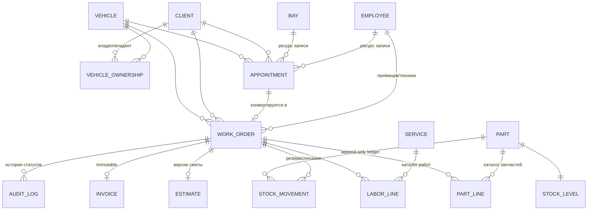

# Обзор open-source решений для CRM автосервиса

**Дата:** 6 ноября 2026
**Цель проекта:** CRM для реального автосервиса. Свой backend на Java (Spring Boot) + свой фронт. Из open-source берём доменную модель, фичи и UX; **код копируем только из проектов под permissive-лицензиями** (MIT / Apache-2.0 / BSD).
**Функциональные блоки:** клиенты + авто + история обслуживаний, заказ-наряды, склад запчастей, запись и календарь.

**Методология:** три параллельных исследования — (A) специализированные системы автосервисов, (B) Java-референсы под permissive-лицензиями, (C) крупные CRM/ERP как источник фич. Лицензии проверялись по LICENSE-файлам (GitHub API), а не по README; активность — по последним коммитам/релизам.

---

## 1. Резюме

**Главный вывод: зрелого open-source DMS для автосервиса не существует.** Ниша состоит из молодых проектов на 1–50 звёзд (что подтверждает и сообщество — на Reddit для автомастерских советуют «обходной путь» через Odoo/ERPNext). Поэтому реалистичная стратегия — та, что выбрана: собрать собственную систему, взяв у каждого донора лучшее.

**Рекомендуемая «сборка» из доноров:**

| Роль | Проект | Что берём |
|---|---|---|
| Скелет модели и статусы заказ-наряда | **BayFlow** (MIT) | Машина состояний бронирования/наряда с RBAC-матрицей переходов, аудит каждого перехода, версионированные сметы с причиной отказа, склад как append-only ledger |
| Широта доменной модели и фич | **Torqvoice** (Elastic License — код не копировать!) | 21 модуль схемы: конфигурируемые статусы наряда, жалобы клиента, findings с OBD-кодами, напоминания «по дате ИЛИ пробегу», рекуррентные ТО, шинное хранилище, кастомные поля |
| Чистый lifecycle наряда и транзакционность | **Workshop DMS / DBM** (без лицензии — только идеи) | draft → approved → in progress → completed → invoiced + hold/cancel; смена статуса + движение склада + бухгалтерская запись в одной транзакции; «estimate vs actual» |
| ER-скелет под MIT | **RepairOS** (MIT, архив) | Готовая схема Customer–Job–Service/Part (junction-таблицы) + Inventory–InventoryTransaction; порт в JPA легален |
| Эталонная модель данных предприятия | **Apache OFBiz** (Apache-2.0) | XML entity-модели: FixedAsset (посты/подъёмники!), WorkEffort (слоты записи), Product + InventoryItem (услуги+запчасти), Order, Party |
| Подсистема записи/календаря | **Pronto** (MIT) | Онлайн-запись без аккаунта, drag-n-drop календарь, запрет двойного бронирования на уровне БД, напоминания за 24ч/1ч (email/Telegram/WhatsApp) |
| Работа с деньгами (идеи) | **FreeSMS** (AGPL — только идеи) | Деньги в minor units (bigint, никогда float), immutable инвойсы с gap-free нумерацией, credit notes вместо правок |
| UX цеха (идеи) | **Dolibarr ServiceGarage** (GPL — только идеи) | Планировщик цеха с детектом конфликтов, публичная подпись клиента по QR, фотофиксация приёмки, VIN-декодер, голосовая диктовка приёмки |

---

## 2. Каталог проектов

### 2.1. Специализированные системы автосервисов

| Проект | Лицензия | Копировать код? | Стек | Активность (посл. push) | Релевантность |
|---|---|---|---|---|---|
| [BayFlow](https://github.com/ZohaibCodez/bayflow-auto-repair-shop-management) | **MIT** | ✅ | Next.js 16, Prisma, PostgreSQL | 2026-10-10 (хакатон) | **5/5** |
| [Torqvoice](https://github.com/Torqvoice/torqvoice) | Elastic License 2.0 | ❌ (source-available) | TypeScript, Next.js 16, Prisma, PostgreSQL | 2026-11-06, 47★ | **5/5** |
| [RepairOS](https://github.com/ChanMeng666/automotive-repair-management-system) | **MIT** (архив) | ✅ | Flask, SQLAlchemy, PostgreSQL | 2026-06, архив 2026-10 | 4/5 |
| [Workshop DMS (DBM)](https://github.com/braxlyco/DBM) | нет | ❌ | Django, SQLite | 2026-10-27 | 4/5 |
| [FreeSMS](https://github.com/RedaEkengren/FreeSMS) | AGPL-3.0 | ❌ | Go, HTMX, PostgreSQL | 2026-11-04 | 4/5 |
| [CarCare (carcareco)](https://github.com/rene98c/carcareco) | AGPL-3.0 | ❌ | ASP.NET Core 9, NHibernate, PostgreSQL | 2026-06-15, 52★ | 4/5 |
| [GarageBuddy](https://github.com/dimitar-grigorov/GarageBuddy) | **MIT** | ✅ | ASP.NET Core 6, EF Core, SQL Server | заморожен с 2024-01 | 3/5 |
| [AXTTON CORE](https://github.com/iMiguel10/axtton-core) | нет | ❌ | FastAPI, PostgreSQL + RLS, React | 2026-11-04 | 3/5 |
| [auto-repair-saas](https://github.com/wangonya/auto-repair-saas) | **Apache-2.0** | ✅ | Django | мёртв с 2021 | 2/5 |
| [Pronto](https://github.com/SGrappelli/pronto) (смежный: запись/POS) | **MIT** | ✅ | Next.js, Supabase | 2026-10-22, 73★ | 3/5 (запись/POS) |
| carRepairSystem | нет | ❌ | Spring Boot (учебный) | мёртв с 2021 | 2/5 |

**Ключевые детали доноров:**

**BayFlow (MIT)** — прямой кандидат на перенос в Java:
- Машина состояний бронирования: Pending → Assigned → «Estimate awaiting approval» → In Progress → «QC pending» → «Ready for pick-up» → Completed; ~21 переход с матрицей «какая роль может выполнить переход» (`src/lib/booking/state-machine.ts`, `rbac.ts` — можно изучать и переносить).
- Роли: Owner, Service Advisor, Technician, Parts Person, QC Inspector, Customer.
- Аудит-лог каждой смены статуса: кто, роль, когда, из → в, заметка.
- Склад: резервирование → распределение → освобождение, append-only ledger, частичные поставки.
- Версионированные сметы: отклонённая версия сохраняется с причиной клиента.
- 4-шаговый мастер онлайн-записи с живой доступностью слотов; согласование/отклонение сметы клиентом в портале.

**Torqvoice (Elastic License 2.0 — смотреть, не копировать):** самая богатая доменная модель. Prisma-схема из 21 модуля: customers, vehicles, service-records (наряды), quotes, billing, inventory, inspections, condition-marks (повреждения при приёмке), tire-hotel, technicians, custom-fields, document-designs, email-templates, messaging, reports, audit, webhooks, import. Интересные решения: статусы наряда конфигурируются справочником, но каждое состояние обязано иметь `stage: pending | in-progress | completed`; `VehicleFinding` с fault-кодами OBD (regex `^[PCBU][0-3][0-9A-F]{3}$`) и severity; напоминания по дате ИЛИ пробегу; рекуррентные инвойсы (подписка на ТО); у Vehicle — hsn/tsn (немецкие коды), архив с причиной.

**Workshop DMS / DBM (без лицензии — только идеи):** самый чистый lifecycle job-карточки: **draft → approved → in progress → completed → invoiced** + ветки **hold** и **cancellation**, с историей статусов; оценка «замораживается» при согласовании; после инвойса карточка read-only; списание запчасти уменьшает склад (реверсия возвращает); estimate-vs-actual variance; раздельные ставки налога на товары/услуги; смена статуса + история + движение склада + бухгалтерская запись в одной транзакции.

**RepairOS (MIT):** полная ER-схема выписана в README — Customer, Job (job_date, total_cost, assigned_to, флаги completed/paid), Service (cost, category, estimated_duration_minutes), Part (sku, supplier), JobService/JobPart (qty — junction-таблицы), Inventory (quantity_on_hand, reorder_level/quantity, location), InventoryTransaction (received/sold/adjusted/returned), мультитенантность. Дыра проекта — нет сущности Vehicle; для нас это урок: авто — центральная сущность.

**FreeSMS (AGPL — идеи):** деньги в minor units (bigint), immutable инвойсы с gap-free нумерацией (защита триггером БД), credit notes вместо правок; цифровые инспекции с фото; approve/decline клиентом каждого finding по ссылке без регистрации; offline-first с идемпотентными ключами.

**AXTTON CORE (без лицензии — идеи):** периоды владения авто (непересекающиеся, constraint EXCLUDE + btree_gist в PostgreSQL) — у авто бывает несколько владельцев во времени; заморозка суммы сметы при отправке клиенту; подписанный лист приёмки и сводка выдачи с гарантией как документ-артефакты; Row-Level Security для изоляции мастерских.

### 2.2. Java-референсы

| Проект | Лицензия | Копировать код? | Стек | Активность | Что берём |
|---|---|---|---|---|---|
| [Apache OFBiz](https://github.com/apache/ofbiz-framework) | **Apache-2.0** | ✅ | Java (JDK 25), Gradle, свой framework; H2/PostgreSQL/MySQL | релиз 24.09.08 от 2026-11-02, ~1.1k★ | Эталонная доменная модель в XML |
| [dromara/skyeye](https://github.com/dromara/skyeye) | **MIT** | ✅ | Spring Boot 2 + MySQL, Activiti | 2026-11-04, 1.2k★ | Модульная структура CRM/ERP, workflow; минус: SB2, дока китайская |
| [jinbooks/cerescrm](https://github.com/jinbooks/cerescrm) | **Apache-2.0** | ✅ | Spring Boot 3 + Vue 3 | 2026-04, 15★ | Компактный современный скелет CRM (auth, справочники, дашборд) |
| [openCRX](https://github.com/opencrx/opencrx) | BSD-3-Clause (неожиданно!) | ✅ (но стек openMDX, не Spring) | Java | 2026-10, 88★ | Идеи моделирования activities/accounts |
| [jmix-crm](https://github.com/jmix-framework/jmix-crm) | **LICENSE-файла нет** | ❌ только идеи | Jmix + Spring Boot + Vaadin | активный | Доменная и ролевая модель B2B CRM |
| iDempiere, metasfresh, CordysCRM, Rebuild | GPL-2.0/GPL-3.0 | ❌ | Java | активные | Идеи ERP-модели |

**Apache OFBiz — почему он главный Java-референс.** Его доменная модель хранится декларативно в XML (`applications/datamodel/entitydef/*.xml`), и её можно легально переносить в свои JPA-сущности:
- `accounting-entitymodel.xml` → **FixedAsset** — так моделируются подъёмники/посты/оборудование (у FixedAsset есть календарь занятости через WorkEffort);
- `workeffort-entitymodel.xml` → **WorkEffort** — универсальная «работа/слот/задача»: и запись клиента, и операция в наряде;
- `product-entitymodel.xml` → услуги и запчасти как единый **Product** + **InventoryItem** для склада;
- `order-entitymodel.xml` → OrderHeader/OrderItem — структура заказа с позициями;
- `party-entitymodel.xml` → **Party** — универсальная сторона (клиент-физлицо, компания, контакт).

**Ловушка, зафиксированная при проверке:** у ряда Java-проектов в README написано «MIT», но LICENSE-файла в репозитории нет → по закону код копировать нельзя (nidabaser/CRM_Spring_Boot, sanket9322/crm-backend, jdubois/crm). Правило: лицензия = только LICENSE-файл. Отдельно: **openCRX оказался BSD-3-Clause**, а не GPL как принято считать, но его не-Spring стек (openMDX) ограничивает пользу. Готовых permissive Java-проектов «автосервис/гараж» не найдено — Java-домен придётся собирать самому из модели выше.

### 2.3. Крупные CRM/ERP — источник фич и UX (код не копируем: GPL/AGPL/LGPL)

| Система | Лицензия | Что взять |
|---|---|---|
| **Odoo** | LGPLv3 (Community) | Модуль Repair: вкладки **Parts** (Demand/фактически израсходовано, статус наличия, серийники, флаг гарантии) и **Services** раздельно; статусы наряда New → Confirmed → Under Repair → Repaired / Cancelled; резервация запчастей при подтверждении. Fleet: поля авто. Appointments: бронируются **пользователи или ресурсы** (посты!), окна доступности, шаг слота, lead-time, capacity, авто-подтверждение, письма-подтверждения и напоминания email/SMS |
| **ERPNext** | GPLv3 | Job Card: **Time Logs по операции** (From/To/Completed Qty — учёт времени механика), шаги Move Materials → Start → Complete; экран «Not Enough Stock» с заявкой на закупку одним действием; planned vs actual cost по операции |
| **Dolibarr (ServiceGarage)** | GPLv3 | Богатейший UX: планировщик цеха (drag-n-drop, цвета техников, детект конфликтов с подбором альтернативы); **публичная подпись клиента по QR-ссылке** (лог IP/устройства/времени); **фотосъёмка авто при приёмке** с телефона; VIN-декодер (VPIC/carVertical); голосовая диктовка приёмки; поиск по госномеру/VIN; карточка RAN — вся история заездов клиента |
| **EspoCRM** | GPLv3 | Паттерн Entity Manager (конструктор сущностей — референс архитектуры кастомных полей); Case-статусы; лента Stream с внутренними заметками; клиентский портал; Email-to-Case; Round-Robin распределение заявок |
| SuiteCRM / Vtiger / YetiForce | AGPL / VPL / YPL | Типовой фичесет кастомизаций: VIN-декодирование, история владения, трекинг дат следующего ТО, заказ запчастей с трекингом прибытия |

---

## 3. Черновик доменной модели

Синтез из всех доноров. Ядро — пятёрка Client / Vehicle / Appointment / WorkOrder / каталог Service+Part (паттерн общий для всех изученных систем).

### 3.1. Сущности

**Client** — клиент (физлицо или юрлицо)
- тип (person/company), имя/название, телефоны[], email, адрес, канал привлечения, согласие на рассылки, заметки
- истории заездов клиента И авто ведутся отдельно (история — на уровне авто: вывод из Dolibarr/Odoo)

**Vehicle** — автомобиль (центральная сущность; урок RepairOS — без неё никуда)
- VIN, госномер (оба — ключи поиска), марка, модель, поколение, год, тип кузова, двигатель (объём/код), тип топлива, трансмиссия, **последний пробег**, категория
- пробег обновляется при каждом заезде (пробег на момент заезда фиксируется в наряде)

**VehicleOwnership** — связь клиент↔авто многие-ко-многим **с периодами владения** (дата с / дата по; непересекающиеся — constraint EXCLUDE, паттерн AXTTON; история владения — паттерн Vtiger)

**Employee** — сотрудник; роли: Owner, Service Advisor (приёмщик), Technician, Parts Person, QC (матрица BayFlow)

**Bay** (пост) — FixedAsset по OFBiz: подъёмник/шиномонтаж/диагностика; календарь занятости

**Service** — работа из каталога: название, категория, цена (нормо-час × ставка или фикс), нормативная длительность

**Part** — запчасть из каталога: SKU, название, производитель, аналоги, закупочная цена, цена продажи, единица

**StockLevel** — остатки: part, склад, количество, reorder_level, reorder_quantity, ячейка

**StockMovement** — append-only ledger движений (BayFlow/FreeSMS/RepairOS): тип (reserve/release/receive/issue/adjust/return), количество, причина, ссылка на наряд/закупку. Остаток = материализованная сумма ledger, правки только новыми движениями

**Appointment** — запись: клиент, авто, услуга(-и), дата/время, длительность, ресурс (техник и/или пост), канал (телефон/онлайн), статус
- статусы: REQUESTED → CONFIRMED → ARRIVED → (CONVERTED в заказ-наряд) / CANCELLED / NO_SHOW
- защита от двойного бронирования — constraint на уровне БД (паттерн Pronto/AXTTON)

**WorkOrder** — заказ-наряд (см. статусную модель ниже): номер, клиент, авто, **пробег на момент заезда**, жалоба клиента (ServiceConcern из Torqvoice), даты (открытия, плановые начала/окончания, фактические), ответственный приёмщик, техники, заметки видимые клиенту / внутренние, фото (приёмка/в процессе/выдача), теги

**WorkOrderLine** — позиции наряда двух типов (паттерн Odoo «две вкладки»):
- **LaborLine**: ссылка на Service, количество, цена, скидка, исполнитель, фактически затраченное время (Time Logs — паттерн ERPNext Job Card)
- **PartLine**: ссылка на Part, **demand** (требуемое), **reserved**, **issued** (фактически израсходовано) — тройка из Odoo; флаг гарантии (не тарифицировать); дедлайн поставки

**Estimate** — смета: версионированная (каждая версия замораживается при отправке, отклонённая сохраняется с причиной — BayFlow/AXTTON); статус draft → sent → approved / rejected → конвертация в WorkOrder

**Invoice** — счёт: **immutable**, gap-free нумерация, деньги в minor units (копейки, bigint), создаётся из наряда одним действием, правки — только credit notes (FreeSMS)

**Document** — артефакты: акт приёмки (подпись клиента, в т.ч. по публичной QR-ссылке), акт выполненных работ, сводка выдачи с гарантией (AXTTON/Dolibarr)

**Reminder** — напоминания клиенту: по дате ИЛИ по пробегу (Torqvoice), тип (ТО, страховка, сезонное хранение шин)

**AuditLog** — кто/что/когда; обязателен для смен статусов наряда: кто, роль, из → в, комментарий (BayFlow)

### 3.2. Статусная машина заказ-наряда

Синтез из Workshop DMS, BayFlow и Odoo:

```
DRAFT → APPROVED → IN_PROGRESS → READY → COMPLETED → INVOICED → CLOSED
           │           │            │
           │           └── ON_HOLD (ждём запчасть / согласование клиента / клиента)
           │
           └──────────────→ CANCELLED (из любого статуса до COMPLETED)
```

- **DRAFT** — открыт, набираются позиции (у DBM: draft)
- **APPROVED** — смета согласована клиентом, запчасти резервируются (у Odoo резерв при Confirm; у DBM смета фиксируется при согласовании)
- **IN_PROGRESS** — работы идут; позиции PartLine списываются по факту (issued)
- **ON_HOLD** — пауза с причиной (нет запчасти — видна заявка на закупку; ожидание клиента); после hold-паузы наряд может возвращаться в IN_PROGRESS
- **READY** — работы завершены, внутренний контроль качества (у BayFlow «QC pending» → «Ready for pick-up»)
- **COMPLETED** — авто выдано клиенту
- **INVOICED** — счёт выставлен, наряд становится read-only (у DBM после invoiced — только чтение)
- Любой переход: запись в AuditLog в той же транзакции; переход «статус + движение склада + бухгалтерская запись» — одна транзакция (DBM)

Каждый статус несёт системный `stage: pending | in-progress | completed` (паттерн Torqvoice) — это позволяет иметь конфигурируемые пользовательские статусы (справочник), не ломая логику.

### 3.3. ER-диаграмма (сокращённая)



---

## 4. Архитектура Spring Boot (рекомендация)

**Формат: модульный монолит.** Для одного автосервиса (и даже сети из нескольких) микросервисы — оверкилл; при этом структура модулей позволит выделить сервисы позже.

**Стек:**
- Java 21 LTS, Spring Boot 3.x
- PostgreSQL (обязательно: constraint EXCLUDE для непересекающихся слотов записи и периодов владения — btree_gist)
- Spring Data JPA + Flyway (миграции — с первого дня, система боевая)
- Spring Security + JWT (RBAC по ролям BayFlow)
- springdoc-openapi (REST-контракт), MapStruct
- Деньги: `BigDecimal` c копейками или long minor units (FreeSMS); никогда float/double
- Testcontainers для интеграционных тестов; PDF-генерация (акты, счёта) — OpenHTMLtoPDF или аналоги

**Модули (по доменам):**
```
crm/
├── crm-common/          — общие типы, деньги, аудит
├── crm-clients/         — Client, Vehicle, VehicleOwnership, история
├── crm-catalog/         — Service, Part (прайс-листы)
├── crm-inventory/       — StockLevel, StockMovement (ledger), закупки
├── crm-appointments/    — Appointment, календарь, слоты, конфликт-детект
├── crm-workorders/      — WorkOrder, линии, Estimate, статусная машина, AuditLog
├── crm-billing/         — Invoice (immutable, gap-free), платежи
├── crm-documents/       — акты приёмки/выдачи, подписи, фото
├── crm-notifications/   — email/SMS/Telegram, Reminder (дата/пробег)
└── crm-api/             — REST-контроллеры, OpenAPI, security config
```

**Ключевые паттерны из референсов:**
1. Статусная машина наряда — как явный компонент с матрицей «роль × переход» (порт `state-machine.ts` из BayFlow, MIT) + AuditLog в той же транзакции.
2. Склад — append-only ledger + материализованные остатки (BayFlow/RepairOS); резерв при APPROVED, списание по факту, реверс при отмене.
3. Запись — запрет двойного бронирования на уровне БД (Pronto), ресурс = техник И/ИЛИ пост (Odoo: Users vs Resources; OFBiz: WorkEffort + FixedAsset).
4. Смета — версии, заморозка при отправке, причина отклонения (BayFlow/AXTTON).
5. Счёт — immutable + gap-free номер + credit notes (FreeSMS).
6. Эталон полей и связей сверять с XML-схемами OFBiz (Apache-2.0 — можно переносить прямо).

---

## 5. Чек-лист фич CRM автосервиса

### Must-have (MVP)

**Клиент и автомобиль**
- [ ] Клиент: имя, телефоны, email, канал привлечения, согласие на рассылки; физлицо/юрлицо
- [ ] Авто: VIN, госномер, марка/модель/поколение, год, пробег; VIN и госномер — ключи поиска
- [ ] Связь клиент↔авто с периодами владения; список авто в карточке клиента
- [ ] История обслуживаний на уровне авто (таймлайн всех заездов)

**Заказ-наряд**
- [ ] Поля: клиент, авто, пробег на момент заезда, даты плановые/фактические, приёмщик, техники, статус
- [ ] Статусная машина (см. §3.2) + аудит переходов
- [ ] Позиции двух типов: работы и запчасти; тройка demand/reserved/issued у запчастей
- [ ] Заметки: видимые клиенту и внутренние
- [ ] Смета: версии, согласование клиентом, конвертация в наряд
- [ ] Учет времени механика по операциям

**Запись и календарь**
- [ ] Запись: клиент, авто, услуга, дата/время, длительность, ресурс (техник/пост), статус
- [ ] Календарь цеха по техникам и постам; детект конфликтов на уровне БД
- [ ] Онлайн-запись: публичная ссылка, окна доступности, шаг слота, lead-time

**Уведомления**
- [ ] Подтверждение записи, напоминание (24ч/1ч), «авто готово»
- [ ] Вся коммуникация — в карточке клиента/наряда

**Каталог и склад**
- [ ] Прайс-лист работ (нормо-часы) и запчастей; цены подтягиваются в наряд
- [ ] Остатки, резерв под наряд, списание по факту, возврат неиспользованного
- [ ] reorder-уровни + заявка на закупку при нехватке; статус наряда ON_HOLD «ждём запчасть»

**Деньги**
- [ ] Счёт из наряда одним действием; immutable, gap-free нумерация, minor units
- [ ] Статус оплаты, частичная оплата/предоплата

### Nice-to-have (отстройка от конкурентов, второй эшелон)

- [ ] Фотографии авто при приёмке/выдаче с телефона, галерея до/после (Dolibarr)
- [ ] Публичная подпись клиента по QR-ссылке с логом IP/времени (Dolibarr)
- [ ] Клиентский портал: статус наряда, согласование сметы, история
- [ ] VIN-декодер (внешний API — VPIC и т.п.)
- [ ] Напоминания о ТО по дате И по пробегу (в своём backend — оба, у Odoo по пробегу нет)
- [ ] Чек-лист осмотра при приёмке + фиксация повреждений (condition marks)
- [ ] Findings с OBD fault-кодами и approve/decline клиентом каждого пункта по ссылке
- [ ] Гарантия на работы (срок/пробег), отслеживание гарантийных повторных заездов
- [ ] Отчёты: загрузка постов, выработка техников, маржа по наряду, estimate vs actual
- [ ] Шинное хранилище («tire hotel») — редкая фича, сильный маркетинговый ход (Torqvoice)
- [ ] Кастомные поля без программирования (референс архитектуры — EspoCRM Entity Manager)
- [ ] Интеграция с Google Calendar техников
- [ ] Мультитенантность (если появится второй сервис) — RLS в PostgreSQL (AXTTON) или схема на тенанта (CarCare)

---

## 6. Roadmap MVP для боевого сервиса

Порядок выбран так, чтобы система приносила пользу как можно раньше, каждый этап — работоспособен сам по себе:

1. **Каркас** — Spring Boot 3 + PostgreSQL + Flyway + Spring Security (RBAC) + OpenAPI. Скелет по cerescrm (Apache-2.0), модель по §3.
2. **Ядро CRM** — клиенты, авто, периоды владения, поиск по госномеру/VIN, история обслуживаний. Уже полезно: карточка клиента вместо бумажного журнала.
3. **Каталог и заказ-наряды** — прайс работ/запчастей, наряд с позициями, смета (версии, согласование), статусная машина + аудит. Система закрывает главный процесс цеха.
4. **Календарь записи** — записи, слоты, ресурсы (техник/пост), конфликт-детект, онлайн-запись по публичной ссылке.
5. **Склад** — ledger остатков, резерв/списание из наряда, reorder-алерты, заявки на закупку.
6. **Деньги и документы** — счёт из наряда (immutable, gap-free), акты приёмки/выдачи PDF, предоплата.
7. **Уведомления** — подтверждение записи, напоминания, «авто готово» (email → SMS/Telegram).
8. **Второй эшелон** — фото приёмки, QR-подписи, портал клиента, VIN-декодер, ТО-напоминания, отчёты.

---

## 7. Источники

- Категория A: [BayFlow](https://github.com/ZohaibCodez/bayflow-auto-repair-shop-management) · [Torqvoice](https://github.com/Torqvoice/torqvoice) · [RepairOS](https://github.com/ChanMeng666/automotive-repair-management-system) · [Workshop DMS](https://github.com/braxlyco/DBM) · [FreeSMS](https://github.com/RedaEkengren/FreeSMS) · [CarCare](https://github.com/rene98c/carcareco) · [GarageBuddy](https://github.com/dimitar-grigorov/GarageBuddy) · [AXTTON CORE](https://github.com/iMiguel10/axtton-core) · [auto-repair-saas](https://github.com/wangonya/auto-repair-saas) · [Pronto](https://github.com/SGrappelli/pronto) · [Medevel: 15 Open-Source Car Repair Apps](https://medevel.com/free-garage-software-15-open-source-car-repair-and-service-apps) · [Reddit: Open Source Mechanic Software](https://www.reddit.com/r/opensource/comments/1bdt73f/open_source_mechanic_software)
- Категория B: [Apache OFBiz](https://github.com/apache/ofbiz-framework) · [OFBiz releases](https://archive.apache.org/dist/ofbiz/) · [dromara/skyeye](https://github.com/dromara/skyeye) · [jinbooks/cerescrm](https://github.com/jinbooks/cerescrm) · [jmix-crm](https://github.com/jmix-framework/jmix-crm) · [openCRX](https://github.com/opencrx/opencrx) · [iDempiere](https://github.com/idempiere/idempiere) · [metasfresh](https://github.com/metasfresh/metasfresh) · [CordysCRM](https://github.com/1Panel-dev/CordysCRM) · [GitHub: crm?l=java](https://github.com/topics/crm?l=java)
- Категория C: [Odoo Repair Orders](https://www.odoo.com/documentation/20.0/applications/inventory_and_mrp/repairs/repair_orders.html) · [Odoo Appointments](https://www.odoo.com/documentation/20.0/applications/productivity/appointments/appointment_types.html) · [Odoo Fleet](https://www.odoo.com/documentation/20.0/applications/hr/fleet/new_vehicle.html) · [ERPNext Work Order](https://docs.frappe.io/erpnext/work-order) · [ERPNext Job Card](https://docs.frappe.io/erpnext/job-card) · [Frappe Discuss: workshop management](https://discuss.frappe.io/t/using-erpnext-for-cars-workshop-management/110726) · [Dolibarr ServiceGarage](https://wiki.dolibarr.org/index.php/Service_Garage_Workshop_Repair) · [EspoCRM Entity Manager](https://docs.espocrm.com/administration/entity-manager/) · [EspoCRM Case Management](https://docs.espocrm.com/user-guide/case-management/) · [SuiteCRM Store](https://store.suitecrm.com) · [Vtiger Automotive](https://www.vtiger.com/blog/crm-for-car-dealerships)
